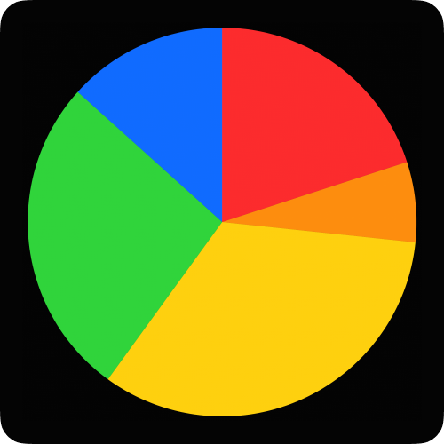

# ApplePie charts

This package creates pie and donut charts for user-understandable representation of your data. Written in Swift using SwiftUI and CoreGraphics frameworks.


 
 


## Why ApplePie?

- Simple Swift Charts like syntax
- Lightweight and fast
- Formatted documentation with step-by-step guide how to create your charts

## Installation

### Swift Package Manager

In Xcode follow `File -> Add Package Dependencies`, then paste the [link](https://github.com/PinkXaciD/ApplePie) to this repo.

## Usage

### Overview


Let's say you have a collection of bakeries and you want to show how many apple pies each of them has in stock.

```swift
struct Bakery {
    let name: String
    let pieCount: Double
    let color: Color
}

let bakeries: [Bakery] = [
    Bakery(name: "Bakery 1", pieCount: 3, color: .red),
    Bakery(name: "Bakery 2", pieCount: 1, color: .orange),
    Bakery(name: "Bakery 3", pieCount: 5, color: .yellow),
    Bakery(name: "Bakery 4", pieCount: 4, color: .green),
    Bakery(name: "Bakery 5", pieCount: 2, color: .blue)
]
```

Import ApplePie into your view.

```swift
import ApplePie
```

You can create a chart by simply providing your data to the `APChart` and creating sectors from it.

```swift
APChart(bakeries) { bakery in
    APChartSector(bakery.pieCount, color: bakery.color)
}
```



### Customizing charts

You can customize the chart by providing parameters like inner radius and separators thickness to the chart.

```swift
APChart(bakeries, separators: 0.3, innerRadius: 0.7) { bakery in
    APChartSector(bakery.pieCount, color: bakery.color)
}
```


You can provide selection parameter to the chart, that way when user clicks or taps on a sector, sector's ID will be asigned to the provided binding. You will need to manually provide an ID of the same type as a selection to the sector.

```swift
@State private var selectedBakery: String? = nil

APChart(bakeries, selection: $selectedBakery) { bakery in
    APChartSector(bakery.pieCount, color: bakery.color, id: bakery.name)
}
```


### Animations

With customization parameters you can provide an animation parameter of SwiftUI `Animation` type. It will animate any changes to the chart data and chart selection.

```swift
APChart(bakeries, animation: .smooth) { bakery in
    APChartSector(bakery.pieCount, color: bakery.color)
}
```
